<p align="center">
  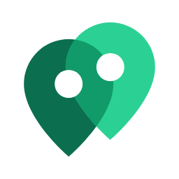
</p>

<h1 align="center">react-native-google-maps-plus</h1>

<p align="center">
  Map and Street View components for React Native.<br />
  Uses the Google Maps SDK for iOS and the Maps SDK for Android, built on Nitro Modules.
</p>

<p align="center">
  <a href="https://www.npmjs.com/package/react-native-google-maps-plus"></a>
  <a href="https://www.npmjs.com/package/react-native-google-maps-plus"></a>
  <a href="https://github.com/pinpong/react-native-google-maps-plus/actions/workflows/release.yml"></a>
  
</p>

<p align="center">
  <a href="https://pinpong.github.io/react-native-google-maps-plus"><b>Documentation</b></a>
  &nbsp;&nbsp;&nbsp;
  <a href="https://pinpong.github.io/react-native-google-maps-plus/docs/examples"><b>Examples</b></a>
  &nbsp;&nbsp;&nbsp;
  <a href="https://pinpong.github.io/react-native-google-maps-plus/docs/api"><b>API reference</b></a>
</p>

<br />

<div align="center">
<table>
  <tr>
    <td align="center"><a href="https://pinpong.github.io/react-native-google-maps-plus/docs/examples/use-cases/ride">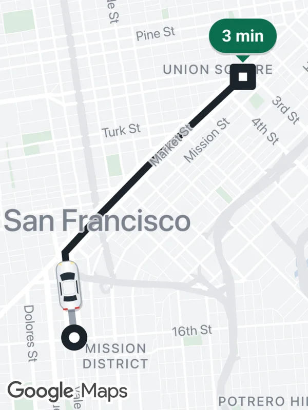</a><br /><sub><b>Ride tracking</b></sub></td>
    <td align="center"><a href="https://pinpong.github.io/react-native-google-maps-plus/docs/examples/use-cases/stores">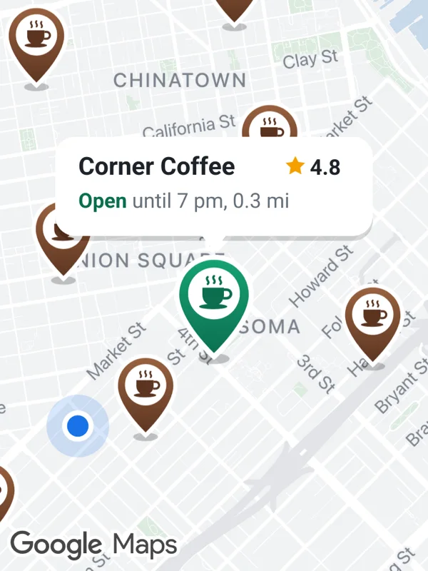</a><br /><sub><b>Store locator</b></sub></td>
    <td align="center"><a href="https://pinpong.github.io/react-native-google-maps-plus/docs/examples/use-cases/transit">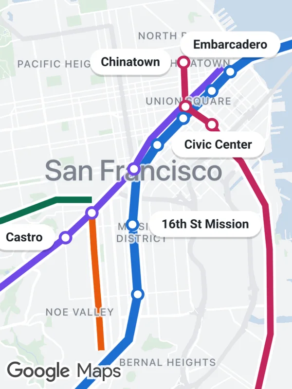</a><br /><sub><b>Transit network</b></sub></td>
    <td align="center"><a href="https://pinpong.github.io/react-native-google-maps-plus/docs/examples/use-cases/heatmap">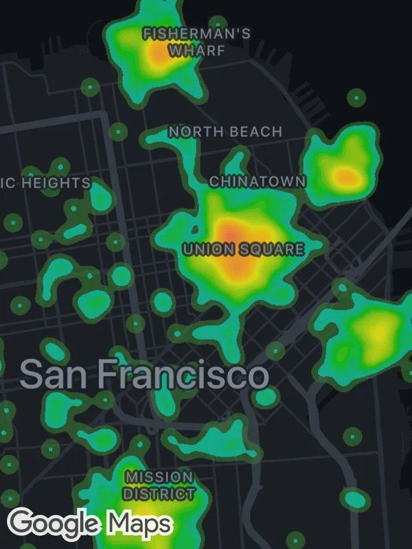</a><br /><sub><b>Analytics</b></sub></td>
    <td align="center"><a href="https://pinpong.github.io/react-native-google-maps-plus/docs/examples/use-cases/hiking">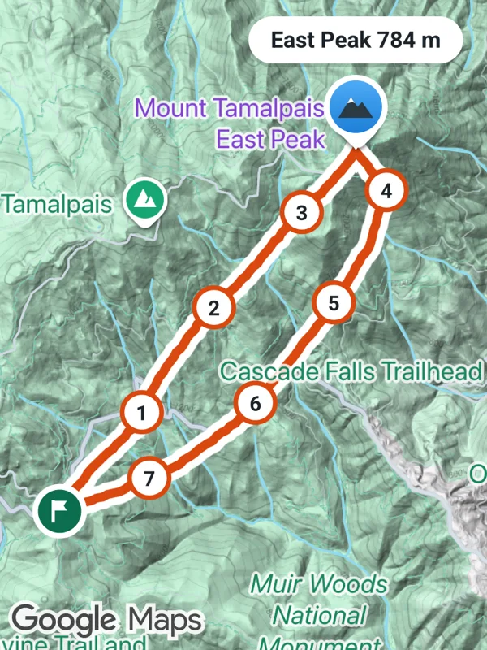</a><br /><sub><b>Outdoor tracking</b></sub></td>
  </tr>
  <tr>
    <td align="center"><a href="https://pinpong.github.io/react-native-google-maps-plus/docs/examples/use-cases/navigation">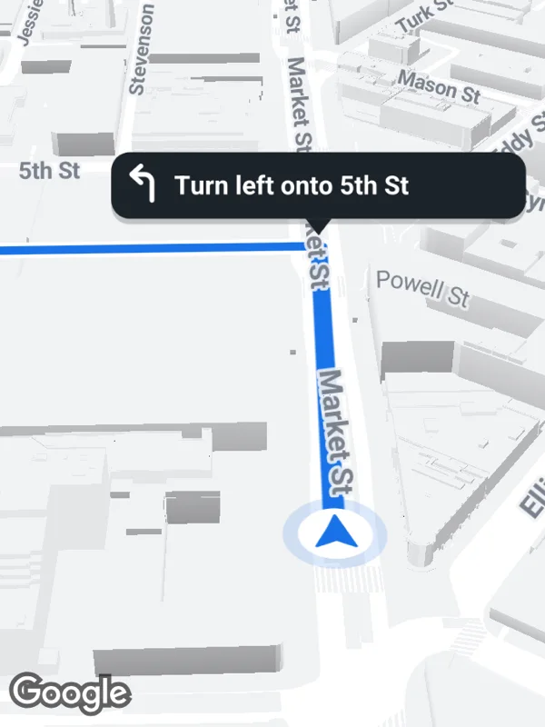</a><br /><sub><b>Navigation</b></sub></td>
    <td align="center"><a href="https://pinpong.github.io/react-native-google-maps-plus/docs/examples/use-cases/rentals">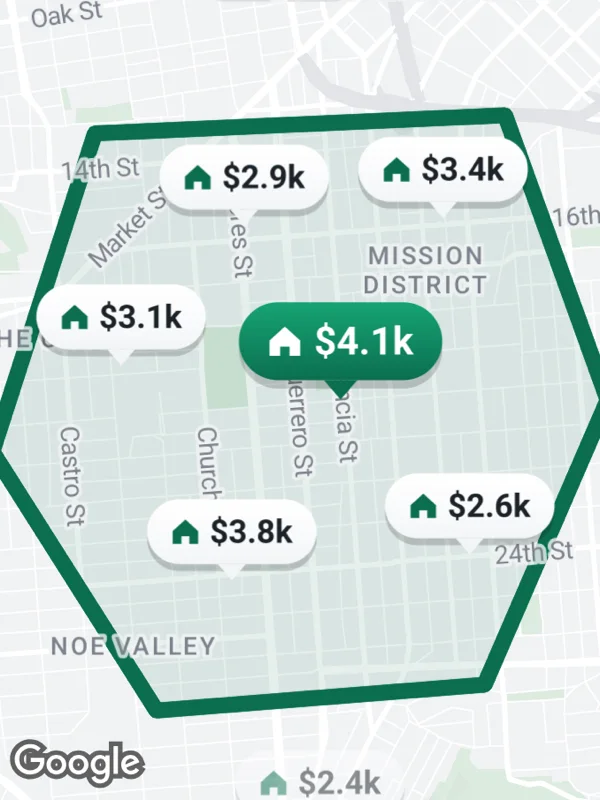</a><br /><sub><b>Rentals</b></sub></td>
    <td align="center"><a href="https://pinpong.github.io/react-native-google-maps-plus/docs/examples/use-cases/friends">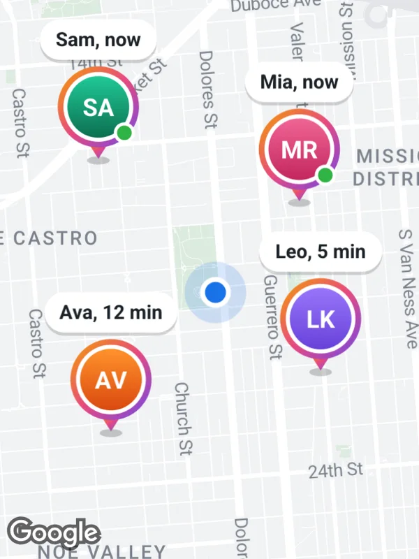</a><br /><sub><b>Friends nearby</b></sub></td>
    <td align="center"><a href="https://pinpong.github.io/react-native-google-maps-plus/docs/examples/use-cases/flights">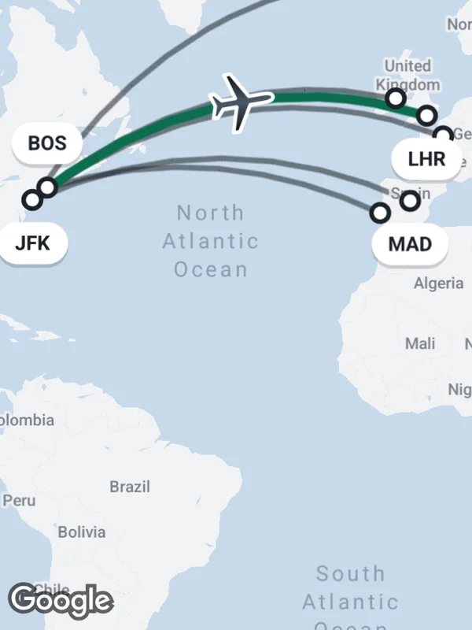</a><br /><sub><b>Flight routes</b></sub></td>
    <td align="center"><a href="https://pinpong.github.io/react-native-google-maps-plus/docs/examples/use-cases/street-view">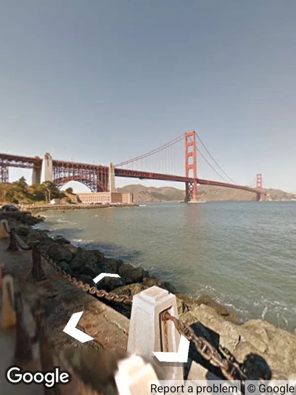</a><br /><sub><b>Street View</b></sub></td>
  </tr>
</table>
</div>

<p align="center"><sub>Top row on iOS, bottom row on Android. Every marker is an SVG. <a href="https://pinpong.github.io/react-native-google-maps-plus/docs/examples">25 examples with code</a>.</sub></p>

## Features

- Map view and Street View panorama
- Markers with SVG icons, rendered with [lunasvg](https://github.com/sammycage/lunasvg)
- Advanced Markers with pins and glyphs
- Polylines, polygons, circles, heatmaps, KML layers and URL tile overlays
- Map styles, map IDs, dark mode, traffic, transit and indoor maps
- Camera control and snapshots
- Location updates, heading and permissions

## Requirements

|              | Minimum                                  |
| ------------ | ---------------------------------------- |
| React Native | 0.87, New Architecture                   |
| iOS          | 16                                       |
| Android      | API 26, Kotlin 2.3                       |
| Expo         | Development build with the config plugin |

## Installation

```sh
yarn add react-native-google-maps-plus react-native-nitro-modules
```

Then set up the Google Maps SDKs and your API keys for iOS and Android, see the [installation guide](https://pinpong.github.io/react-native-google-maps-plus/docs/guides/installation).

## Usage

```tsx
import { GoogleMapsView } from 'react-native-google-maps-plus';

export default function App() {
  return (
    <GoogleMapsView
      style={{ flex: 1 }}
      mapOptions={{
        camera: {
          center: { latitude: 37.7749, longitude: -122.4194 },
          zoom: 12,
        },
      }}
      markers={[
        {
          id: 'ferry-building',
          coordinate: { latitude: 37.7955, longitude: -122.3937 },
        },
      ]}
    />
  );
}
```

Overlays are props, callbacks report what the user does and the ref moves the camera. See [Usage](https://pinpong.github.io/react-native-google-maps-plus/docs/guides/usage) and the [examples](https://pinpong.github.io/react-native-google-maps-plus/docs/examples).

## Documentation

- [Installation](https://pinpong.github.io/react-native-google-maps-plus/docs/guides/installation)
- [Usage](https://pinpong.github.io/react-native-google-maps-plus/docs/guides/usage)
- [Upgrading from 1.x](https://pinpong.github.io/react-native-google-maps-plus/docs/guides/upgrading-from-1x)
- [SVG markers](https://pinpong.github.io/react-native-google-maps-plus/docs/guides/svg-markers)
- [Advanced markers](https://pinpong.github.io/react-native-google-maps-plus/docs/guides/advanced-markers)
- [Troubleshooting](https://pinpong.github.io/react-native-google-maps-plus/docs/guides/troubleshooting)
- [Limitations](https://pinpong.github.io/react-native-google-maps-plus/docs/guides/limitations)
- [API reference](https://pinpong.github.io/react-native-google-maps-plus/docs/api)
- [llms.txt](https://pinpong.github.io/react-native-google-maps-plus/llms.txt) for AI tools

## Contributing

- [Development workflow](CONTRIBUTING.md#development-workflow)
- [Docs website](CONTRIBUTING.md#docs-website)
- [Sending a pull request](CONTRIBUTING.md#sending-a-pull-request)
- [Code of conduct](CODE_OF_CONDUCT.md)

## License

MIT
